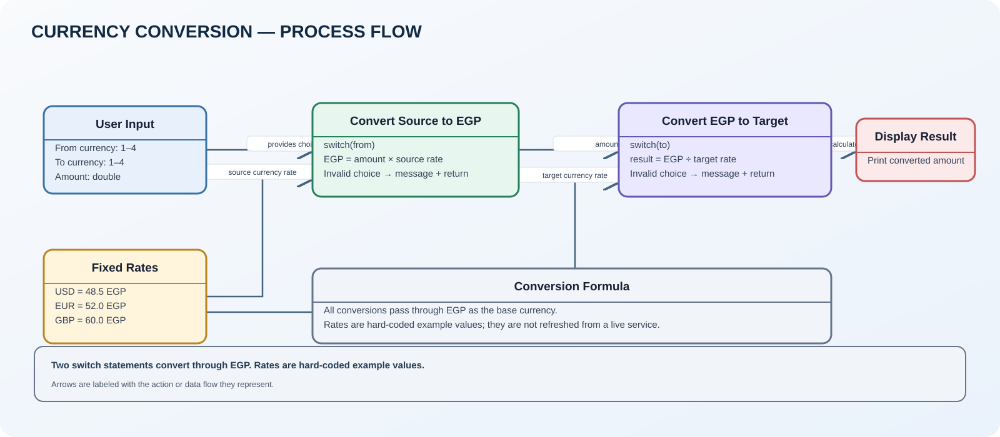

# Currency Conversion Software

A console program that converts an amount between EGP, USD, EUR, and GBP.

## Run

Open [CurrencyConverter.slnx](CurrencyConverter.slnx) in Visual Studio, or run:

```bash
dotnet run --project CurrencyConverter.csproj
```

## Conversion flow



- [Open the editable Draw.io diagram](CurrencyConverter.drawio)
- [Source code](Program.cs)

## How it works

1. The user selects a source currency and a target currency.
2. The amount is first converted to EGP.
3. A second switch converts the EGP amount to the selected target currency.
4. The result is printed to the console.

## Review notes

- The rates are fixed constants in the source: USD = 48.5 EGP, EUR = 52.0 EGP, GBP = 60.0 EGP. They are example values, not live exchange rates.
- `int.Parse` and `double.Parse` are used without input validation. Non-numeric input can terminate the program with a parsing exception.
- The program checks invalid currency selections, but does not check whether the amount is positive or whether the source and target currencies are the same.
- `double` is used for amounts. For financial applications, decimal arithmetic and a reliable rate source would be more suitable.

The original Program.cs logic has been preserved in this upload.
