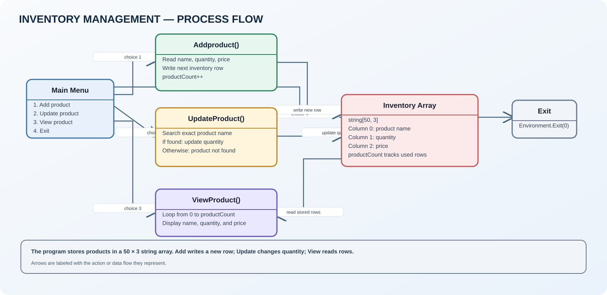

# Inventory Management System

A console program for adding products, updating product quantities, and viewing the current inventory.

## Run

Open [InventoryManagementSystem.slnx](InventoryManagementSystem.slnx) in Visual Studio, or run:

```bash
dotnet run --project InventoryManagementSystem.csproj
```

## Program flow



- [Open the editable Draw.io diagram](InventoryManagementSystem.drawio)
- [Source code](Program.cs)

## How it works

- Stores up to 50 product rows in a two-dimensional string array.
- Each row has three values: product name, quantity, and price.
- The menu supports Add, Update, View, and Exit.
- Update searches for an exact product-name match and changes its quantity.

## Review notes

- The array has a fixed capacity of 50, but Addproduct does not check whether productCount has reached that limit. Adding more than 50 products can cause an index error.
- Menu input uses Convert.ToInt32 without validation. Non-numeric input can terminate the program.
- Product name, quantity, and price are stored as strings. Numeric validation is not performed.
- Updating a product changes quantity only; price cannot currently be updated.
- Products are stored only in memory and are lost when the application exits.
- There is no default switch case for an unrecognized menu option.
- The source includes an unused `System.Threading.Channels` using directive.

The original Program.cs logic has been preserved in this upload.
