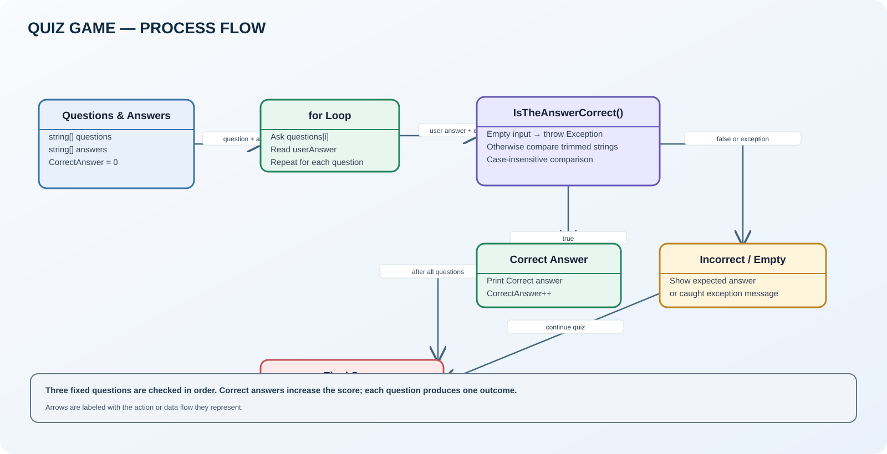

# Quiz Game

A short console quiz that checks three answers and displays the final score.

## Run

Open [QuizGame.slnx](QuizGame.slnx) in Visual Studio, or run:

```bash
dotnet run --project QuizGame.csproj
```

## Quiz flow



- [Open the editable Draw.io diagram](QuizGame.drawio)
- [Source code](Program.cs)

## How it works

1. Stores questions and matching answers in two arrays.
2. Loops through each question and reads the user's answer.
3. Calls `IsTheAnswerCorrect` to compare the answer.
4. Increments the score for a correct answer.
5. Displays the final score out of the total number of questions.

## Review notes

- Answer matching is exact and case-sensitive. For example, `mars` does not match `Mars`.
- Leading or trailing spaces are not removed before comparison.
- An empty answer throws a general Exception, which is caught and shown to the user.
- The quiz contains three fixed questions and does not currently support replay, random question order, or configurable questions.
- The second question asks for the biggest country without saying “by area”; the stored answer is Russia.

The original Program.cs logic has been preserved in this upload.
