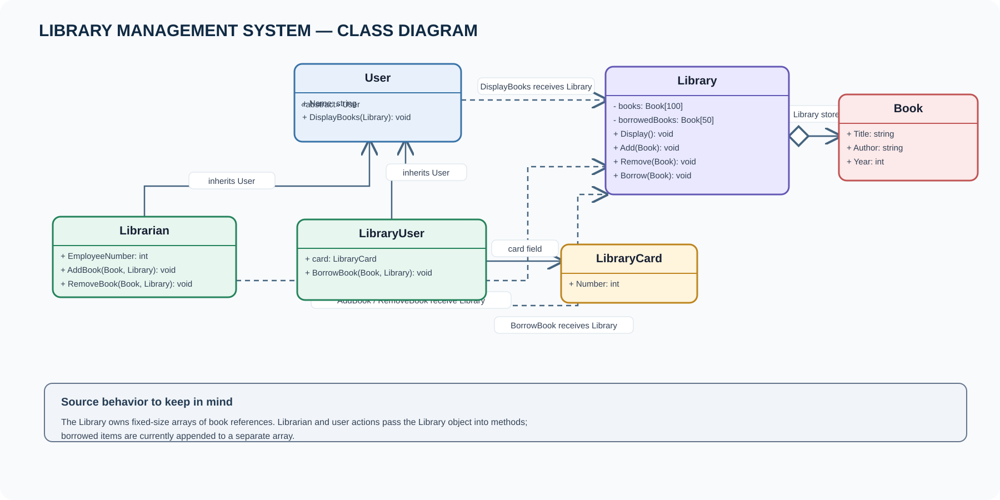

# Library Management System

A console-based library example using classes, inheritance, and basic relationships.

## Run

Open [LibraryManagementSystem.slnx](LibraryManagementSystem.slnx) in Visual Studio, or run:

```bash
dotnet run --project LibraryManagementSystem.csproj
```

## Class diagram



- [Open the editable Draw.io diagram](LibraryManagementSystem.drawio)

## Main types

| Type | Responsibility |
|---|---|
| `User` | Abstract base type with a name and shared book-display operation. |
| `Librarian` | Adds and removes books through the `Library` object. |
| `LibraryUser` | Displays books, borrows a book, and has a `LibraryCard` field. |
| `Library` | Stores book and borrowed-book arrays; provides display, add, remove, and borrow methods. |
| `Book` | Holds title, author, and year. |
| `LibraryCard` | Holds a card number. |

## Review notes from the submitted source

The source files are preserved from the uploaded project; these are review observations, not changes made during upload:

- A new `Library` starts with empty arrays, so a regular user has no books to view or borrow unless books were added earlier in the same run.
- `Borrow(Book)` adds the supplied object to the borrowed array but does not check that the book is in the library or remove it from the available-book array.
- `LibraryUser.card` is declared but is not initialized or used by the current console flow.
- The menus use `ReadLine().ToUpper()[0]`; empty input can cause an indexing error. The year input uses `Convert.ToInt32`, which can throw on invalid text.
- Book storage is fixed-size (100 available entries and 50 borrowed entries), and the records exist only in memory for the current run.

The diagram documents relationships visible in the submitted classes. Arrow captions explain what each relationship means.
