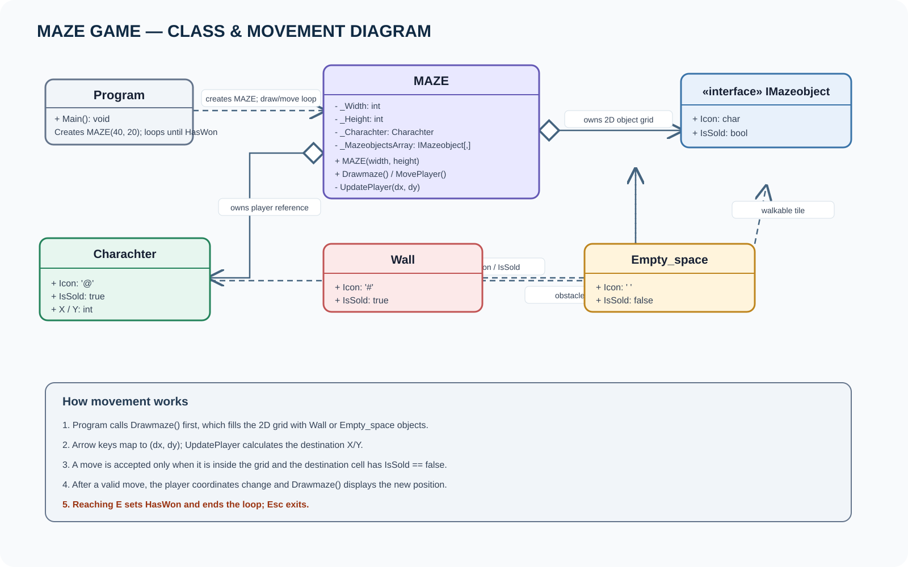

# Maze Game

A console maze demo using an interface, a two-dimensional object grid, and keyboard movement.

## Run

Open [MazeGame.slnx](MazeGame.slnx) in Visual Studio, or run:

```bash
dotnet run --project MazeGame.csproj
```

Use the arrow keys to move the player (`@`). Walls are shown as `#`; empty cells are spaces.

## Class diagram



- [Open the editable Draw.io diagram](MazeGame.drawio)

## Main types

| Type | Responsibility |
|---|---|
| `IMazeobject` | Common contract: `Icon` and `IsSold`. |
| `MAZE` | Owns the grid and player, draws the maze, reads movement keys, and validates moves. |
| `Charachter` | Player object; icon `@`, current X/Y coordinates, and `IsSold = true`. |
| `Wall` | Obstacle object; icon `#` and `IsSold = true`. |
| `Empty_space` | Walkable cell; a blank icon and `IsSold = false`. |
| `Program` | Creates a 40×20 maze and repeats draw/move operations. |

## Movement flow

1. `Program` calls `Drawmaze()` to initialize and display the grid.
2. `MovePlayer()` reads one key and maps an arrow key to a coordinate change.
3. `UpdatePlayer(dx, dy)` calculates the next X/Y position.
4. The move is accepted only when it is inside the grid and the destination cell has `IsSold == false`.
5. After a successful move, the player coordinates update and the maze is redrawn.

## Review notes from the submitted source

The uploaded C# files are preserved; these are observations about the current behavior:

- The opening at the bottom-right edge is drawn as empty space, but no win/exit detection or end condition is implemented. The main loop continues indefinitely.
- The player is stored separately from the cell array; `Charachter.IsSold` is true, but the current player cell is not written into `_MazeobjectsArray`.
- The grid cells are populated during `Drawmaze()`. Calling `MovePlayer()` before the first draw would leave destination cells uninitialized.
- The constructor does not validate width and height. Very small or non-positive dimensions may produce invalid player positions or drawing behavior.
- The obstacle pattern is generated where both X and Y are divisible by 3, or both are divisible by 5; it is a deterministic pattern rather than a path-solving maze generator.
- Original class and member spellings (`MAZE`, `Charachter`, `IMazeobject`, `Empty_space`, `Drawmaze`) are retained from the submitted project.

The class diagram describes the current implementation and labels each arrow with the relationship or flow it represents.
