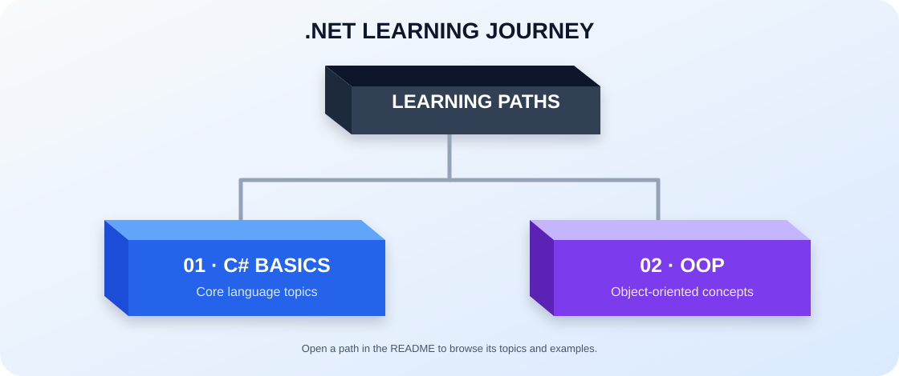

# .NET Learning Journey

Learn C# step by step through small, focused examples.

## Learning tree

- [01 — C# Basics](01-Basics/README.md)
  - [Data Types & Conversions](01-Basics/Examples/01-Data-Types/01-DataTypes.cs)
    - [Conversions](01-Basics/Examples/01-Data-Types/02-Conversions.cs)
    - [Value Types](01-Basics/Examples/01-Data-Types/03-ValueTypes.cs)
    - [Reference Types](01-Basics/Examples/01-Data-Types/04-ReferenceTypes.cs)
    - [Constants](01-Basics/Examples/01-Data-Types/05-Constants.cs)
  - [Strings](01-Basics/Examples/02-Strings/01-Format.cs)
    - [String Manipulation](01-Basics/Examples/02-Strings/02-StringManipulation.cs)
    - [Escape Sequences](01-Basics/Examples/02-Strings/03-EscapeSequences.cs)
    - [Interpolated and Verbatim Strings](01-Basics/Examples/02-Strings/04-InterpolatedVerbatimStrings.cs)
  - [Date & Time](01-Basics/Examples/03-Date-Time/01-DateTime.cs)
    - [DateOnly and TimeOnly](01-Basics/Examples/03-Date-Time/02-DateOnlyTimeOnly.cs)
  - [Input & Operators](01-Basics/Examples/04-Input-and-Operators/01-UserInput.cs)
    - [Arithmetic Operators](01-Basics/Examples/04-Input-and-Operators/02-ArithmeticOperators.cs)
    - [Logical Operators](01-Basics/Examples/04-Input-and-Operators/03-LogicalOperators.cs)
    - [Ternary Operator](01-Basics/Examples/04-Input-and-Operators/04-TernaryOperator.cs)
  - [Conditions & Validation](01-Basics/Examples/05-Conditions/01-IfStatement.cs)
    - [Switch Statement](01-Basics/Examples/05-Conditions/02-SwitchStatement.cs)
    - [Nullable Types](01-Basics/Examples/05-Conditions/03-NullableTypes.cs)
    - [TryParse](01-Basics/Examples/05-Conditions/04-TryParse.cs)
  - [Loops & Patterns](01-Basics/Examples/06-Loops/01-ForLoop.cs)
    - [Foreach Loop](01-Basics/Examples/06-Loops/02-ForeachLoop.cs)
    - [While and Do-While](01-Basics/Examples/06-Loops/03-WhileDoWhile.cs)
    - [Nested Loops](01-Basics/Examples/06-Loops/04-NestedLoops.cs)
    - [Triangle Patterns](01-Basics/Examples/06-Loops/05-TrianglePatterns.cs)
  - [Mathematics](01-Basics/Examples/07-Mathematics/01-MathFunctions.cs)
    - [Random Number Generation](01-Basics/Examples/07-Mathematics/02-RandomNumberGeneration.cs)
  - [Arrays](01-Basics/Examples/08-Arrays/01-Arrays.cs)
    - [Traversing 1D Array](01-Basics/Examples/08-Arrays/02-TraversingOneDimensionalArray.cs)
    - [Bubble Sort](01-Basics/Examples/08-Arrays/03-BubbleSort.cs)
    - [Multidimensional Arrays](01-Basics/Examples/08-Arrays/04-MultidimensionalArrays.cs)
    - [Jagged Arrays](01-Basics/Examples/08-Arrays/05-JaggedArrays.cs)
    - [Jagged Multidimensional Arrays](01-Basics/Examples/08-Arrays/06-JaggedMultidimensionalArrays.cs)
    - [Ranges and Indices](01-Basics/Examples/08-Arrays/07-RangesAndIndices.cs)

- [02 — Object-Oriented Programming](02-OOP/README.md)
  - **Fundamentals**
    - [Return Types](02-OOP/Examples/01-Fundamentals/01-ReturnTypes.cs)
    - [Access Modifiers](02-OOP/Examples/01-Fundamentals/02-AccessModifiers.cs)
    - [Classes and Objects](02-OOP/Examples/01-Fundamentals/03-ClassesAndObjects.cs)
    - [Static Classes](02-OOP/Examples/01-Fundamentals/04-StaticClasses.cs)
    - [Sealed Classes](02-OOP/Examples/01-Fundamentals/05-SealedClasses.cs)
    - [Partial Classes](02-OOP/Examples/01-Fundamentals/06-PartialClasses.cs)
    - [Nested Classes](02-OOP/Examples/01-Fundamentals/07-NestedClasses.cs)
  - **Methods**
    - [Pass by Value](02-OOP/Examples/02-Methods/01-PassByValue.cs)
    - [Pass by Reference](02-OOP/Examples/02-Methods/02-PassByReference.cs)
    - [Method Overloading](02-OOP/Examples/02-Methods/03-MethodOverloading.cs)
    - [Static Methods](02-OOP/Examples/02-Methods/04-StaticMethods.cs)
    - [Extension Methods](02-OOP/Examples/02-Methods/05-ExtensionMethods.cs)
    - [Recursive Methods](02-OOP/Examples/02-Methods/06-RecursiveMethods.cs)
  - **Constructors**
    - [Default Constructor](02-OOP/Examples/03-Constructors/01-DefaultConstructor.cs)
    - [Parameterized Constructor](02-OOP/Examples/03-Constructors/02-ParameterizedConstructor.cs)
    - [Copy Constructor](02-OOP/Examples/03-Constructors/03-CopyConstructor.cs)
    - [Private Constructor](02-OOP/Examples/03-Constructors/04-PrivateConstructor.cs)
    - [Static Constructor](02-OOP/Examples/03-Constructors/05-StaticConstructor.cs)
  - **OOP Principles**
    - [Inheritance](02-OOP/Examples/04-OOP-Principles/01-Inheritance.cs)
    - [Encapsulation](02-OOP/Examples/04-OOP-Principles/02-Encapsulation.cs)
    - [Polymorphism](02-OOP/Examples/04-OOP-Principles/03-Polymorphism.cs)
    - [Abstraction and Abstract Classes](02-OOP/Examples/04-OOP-Principles/04-AbstractClasses.cs)
  - **Types and Keywords**
    - [Namespaces](02-OOP/Examples/05-Types-And-Keywords/01-Namespaces.cs)
    - [Structs](02-OOP/Examples/05-Types-And-Keywords/02-Structs.cs)
    - [Class vs Struct](02-OOP/Examples/05-Types-And-Keywords/03-ClassVsStruct.cs)
    - [This Keyword](02-OOP/Examples/05-Types-And-Keywords/04-ThisKeyword.cs)
    - [Enumerations](02-OOP/Examples/05-Types-And-Keywords/05-Enumerations.cs)
    - [Interfaces](02-OOP/Examples/05-Types-And-Keywords/06-Interfaces.cs)
  - **Exceptions and Resources**
    - [Exception Handling](02-OOP/Examples/06-Exceptions-And-Resources/01-ExceptionHandling.cs)
    - [Finalizers and Destructors](02-OOP/Examples/06-Exceptions-And-Resources/02-Finalizers.cs)
    - [Documentation Comments](02-OOP/Examples/06-Exceptions-And-Resources/03-DocumentationComments.cs)
    - [IDisposable and Dispose](02-OOP/Examples/06-Exceptions-And-Resources/04-IDisposableAndDispose.cs)
    - [Async vs .Result](02-OOP/Examples/06-Exceptions-And-Resources/05-AsyncVsResult.cs)
  - **Streams and Files**
    - [Stream I/O](02-OOP/Examples/07-Streams-And-Files/01-StreamIO.cs)
    - [DeflateStream](02-OOP/Examples/07-Streams-And-Files/02-DeflateStream.cs)
  - **Practical Examples**
    - [Bank Account Example](02-OOP/Examples/08-Practical-Examples/01-BankAccountExample.cs)
    - [Object Relationships](02-OOP/Examples/08-Practical-Examples/02-ObjectRelationships.cs)

### Practical OOP projects

- [Library Management System](02-OOP/Projects/LibraryManagementSystem/README.md) — [Editable diagram](02-OOP/Projects/LibraryManagementSystem/LibraryManagementSystem.drawio)
- [Maze Game](02-OOP/Projects/MazeGame/README.md) — [Editable diagram](02-OOP/Projects/MazeGame/MazeGame.drawio)

Open a topic to view its explanation and C# example.