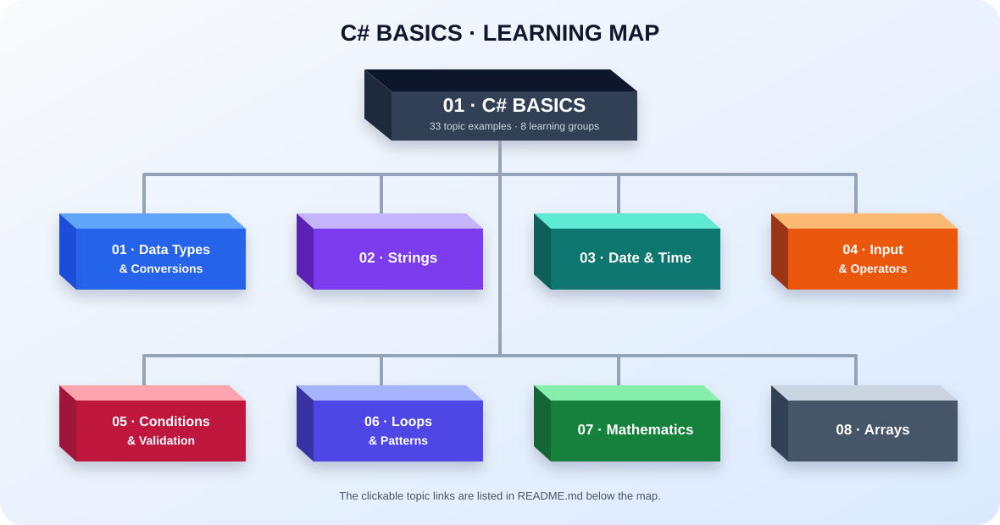

# .NET Learning Journey

Learn C# step by step through small, focused examples.

## Learning tree

- [01 — C# Basics](01-Basics/README.md)
  - [Data Types](01-Basics/Examples/01-Data-Types/01-DataTypes.cs)
    - [Conversions](01-Basics/Examples/01-Data-Types/02-Conversions.cs)
    - [Value Types](01-Basics/Examples/01-Data-Types/03-ValueTypes.cs)
    - [Reference Types](01-Basics/Examples/01-Data-Types/04-ReferenceTypes.cs)
    - [Constants](01-Basics/Examples/01-Data-Types/05-Constants.cs)
  - [Format and StringBuilder](01-Basics/Examples/02-Strings/01-Format.cs)
    - [String Manipulation](01-Basics/Examples/02-Strings/02-StringManipulation.cs)
    - [Escape Sequences](01-Basics/Examples/02-Strings/03-EscapeSequences.cs)
    - [Interpolated and Verbatim Strings](01-Basics/Examples/02-Strings/04-InterpolatedVerbatimStrings.cs)
  - [DateTime](01-Basics/Examples/03-Date-Time/01-DateTime.cs)
    - [DateOnly and TimeOnly](01-Basics/Examples/03-Date-Time/02-DateOnlyTimeOnly.cs)
  - [Get Input From User](01-Basics/Examples/04-Input-and-Operators/01-UserInput.cs)
    - [Arithmetic Operators](01-Basics/Examples/04-Input-and-Operators/02-ArithmeticOperators.cs)
    - [Logical Operators](01-Basics/Examples/04-Input-and-Operators/03-LogicalOperators.cs)
    - [Ternary Operator](01-Basics/Examples/04-Input-and-Operators/04-TernaryOperator.cs)
  - [If Statement](01-Basics/Examples/05-Conditions/01-IfStatement.cs)
    - [Switch Statement](01-Basics/Examples/05-Conditions/02-SwitchStatement.cs)
    - [Nullable Types](01-Basics/Examples/05-Conditions/03-NullableTypes.cs)
    - [TryParse](01-Basics/Examples/05-Conditions/04-TryParse.cs)
  - [For Loop](01-Basics/Examples/06-Loops/01-ForLoop.cs)
    - [Foreach Loop](01-Basics/Examples/06-Loops/02-ForeachLoop.cs)
    - [While and Do-While](01-Basics/Examples/06-Loops/03-WhileDoWhile.cs)
    - [Nested Loops](01-Basics/Examples/06-Loops/04-NestedLoops.cs)
    - [Triangle Patterns](01-Basics/Examples/06-Loops/05-TrianglePatterns.cs)
  - [Math Functions](01-Basics/Examples/07-Mathematics/01-MathFunctions.cs)
    - [Random Number Generation](01-Basics/Examples/07-Mathematics/02-RandomNumberGeneration.cs)
  - [Arrays](01-Basics/Examples/08-Arrays/01-Arrays.cs)
    - [Traversing 1D Array](01-Basics/Examples/08-Arrays/02-TraversingOneDimensionalArray.cs)
    - [Bubble Sort](01-Basics/Examples/08-Arrays/03-BubbleSort.cs)
    - [Multidimensional Arrays](01-Basics/Examples/08-Arrays/04-MultidimensionalArrays.cs)
    - [Jagged Arrays](01-Basics/Examples/08-Arrays/05-JaggedArrays.cs)
    - [Jagged Multidimensional Arrays](01-Basics/Examples/08-Arrays/06-JaggedMultidimensionalArrays.cs)
    - [Ranges and Indices](01-Basics/Examples/08-Arrays/07-RangesAndIndices.cs)
- [02 — Object-Oriented Programming](02-OOP/%20README.md)

Open a topic to view its explanation and C# example.